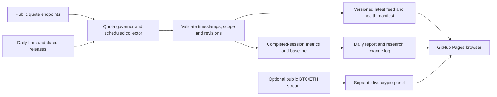

# Market Rotation Monitor: freshness and research upgrade

Prepared **21 October 2026, Singapore time**. This is a proposal, not an activated refresh schedule. It reassesses the original monitoring task against the current implementation and the inspected OpenStock source.

## 1. Product direction

Build a dashboard that answers **what changed, how fresh is the evidence, and what deserves investigation across equities, duration, credit, gold, crypto and cash**. Preserve the twelve core references and the original sequence: macro → measured flows → positioning → price confirmation → interpretation → research priorities. Portfolio sizing and execution remain outside this monitor.

The principal new feature should be **Freshness & Changes**: an updating market view with per-source timestamps, a change tape, refresh controls that respect a shared request budget, and an immutable completed-session baseline. Faster changing numbers alone would not resolve the missing flow, positioning and release evidence.

Retain the existing constraints: **$0 incremental cost, no new service accounts, public machine-readable sources, existing GitHub account, no paid model calls**. A free API requiring registration does not meet the present no-account condition. No actual provider allotment or account quota has been supplied; the numerical budgets below are proposed application ceilings, not claims about permitted vendor quotas.

## 2. Current position and immediate gaps

- The existing interface already has five screens, search/filter/sort, charts and asset drawers, completed-bar technical evidence, Treasury context, watch states, browser snapshots and report exports. Extend these rather than rebuilding a stock terminal.
- The Pages browser polls published JSON every minute, but the collector runs daily around 08:17 SGT. That minute timer does not collect fresh API observations.
- Every current equity refresh requests five years of history. Crypto refresh requests a ticker, rolling statistics and daily candles for each of BTC/ETH. These routes must be separated before increasing collection frequency.
- The 36-hour overdue rule fits daily publications; it would conceal missed intraday updates. New freshness policies must be specific to each dataset and market session.
- The publisher retains last-good values through an Actions cache. This cache is disposable and cannot be the sole authoritative record of quota consumption or close baselines.
- Current real measured-flow imports remain zero. DXY, HY spreads, positioning, release calendars and fundamentals remain unconnected. These limits should remain conspicuous after the upgrade.
- Local code is `ad6c494100848e0997956cd269e2394f2d968394`. The remote now has `dfc343dd442b24b43f6b5545996d6d7aef00a4a7`, after a CNAME addition/removal; the final source tree and publishing workflow are unchanged. Preserve these remote commits when implementation begins.

New checks on 21 October still received **proxy tunnel 403 errors** for the GitHub API/site, Coinbase ticker, Yahoo short chart and Treasury feed. The cloud configuration now lists the required hosts, but successful access is not established. These are environment access failures, not evidence that upstream APIs reject the product. Pages deployment and Actions status remain unverified from this environment.

## 3. What to learn from OpenStock

Inspected revision: [`855ca6af33ae0b86f8835ecda6c31707f4ec3891`](https://github.com/Open-Dev-Society/OpenStock/tree/855ca6af33ae0b86f8835ecda6c31707f4ec3891). Source was read locally; its application was not installed or executed.

| OpenStock pattern                                                        | Adaptation for this monitor                                                                                                                                  |
| ------------------------------------------------------------------------ | ------------------------------------------------------------------------------------------------------------------------------------------------------------ |
| Explicit cached/realtime modes                                           | Offer **Close baseline**, **Latest published**, and an optional **Live crypto** panel. Show actual observation age independently of mode.                    |
| Market pulse tiles and session clock                                     | Keep the four cross-asset headline cards; add NYSE state/countdown and SGT time using our holiday/early-close calendar.                                      |
| Visible-tab quote polling                                                | Fetch the small publication manifest while visible; pause hidden/offline tabs, coalesce tabs, and fetch quote payloads only after a generation changes.      |
| Shared quote cache, in-flight request deduplication and failure cooldown | One scheduled collector serves all visitors. Cache quotes and history separately; impose a persistent request governor before provider calls.                |
| Watchlist, asset details and restrained price flashes                    | Pin/reorder the twelve references locally, preserve chart/range selections, and briefly mark genuine price changes. Respect reduced-motion preferences.      |
| Scheduled alerts                                                         | Add data-health and research-state changes to a visible change tape. Use completed inputs for technical alerts and provisional labels for quote-only events. |

Important differences found in the code:

- OpenStock's README distinguishes its hourly shared community quotes from its 15-second self-hosted/Finnhub-key mode. Its live quote route uses authenticated sessions and MongoDB-backed limits. Those services do not transfer directly to a no-account Pages site.
- Its `DataFreshness` component can show “Live · 15s” from configuration alone. Our labels must come from actual trade/candle times, collection results and stream state; a selected mode is not proof of freshness.
- Its NYSE clock explicitly ignores holidays and half-days. Keep our existing `exchange_calendars` logic and publish a calendar-derived session envelope for the browser.
- TradingView charts are third-party embeds, not an exportable source for our calculations. Keep optional embeds separate from numerical evidence; verify exchange-specific delay/attribution requirements before using them.
- Use the design and architecture as reference. No OpenStock code has been copied. Its source is AGPL-3.0; any later code reuse needs the corresponding source/attribution obligations handled in the implementation.

## 4. Recommended architecture within the existing budget

**Recommended default: scheduled shared feeds on GitHub Pages, with an optional browser-only crypto stream after verification.** Do not move the entire application to OpenStock's server/database/email stack.

### Two clocks, separate evidence

1. **Close baseline:** the latest verified completed NYSE session and daily-bar indicators. Remains stable until a newer completed baseline is validated. Archive the daily research report around 08:17 SGT, with actual capture time.
2. **Current activity:** latest published ETF quotes and separately dated crypto observations. Never overwrite the close baseline, recalculate daily indicators from intraday ticks, or supply a missing exact-US-close crypto mark from a different clock.

Separate datasets: `quotes`, `daily-bars/metrics`, `macro`, `flows`, `positioning`, `calendar`, `reports`. Each carries observation/period, publication when known, retrieval, source, units, scope, revision and status. The manifest records generation IDs, content hashes, last success/attempt, expected cadence and next eligible refresh.

### Collection and publishing

- Build/test the UI on code changes. Reuse a verified static shell for data publications; do not reinstall Node dependencies, rerun every test or rebuild Next.js for every quote update. A missing/incompatible shell cache triggers a bounded rebuild.
- Add a separate data workflow with the same concurrency group as the code publisher. It checks the XNYS calendar before spending equity requests, merges source updates, then deploys a complete consistent generation.
- Use a dedicated public data branch for the small authoritative budget ledger and baseline pointers. Reserve a batch's maximum request cost **before** provider calls; cancelled or failed work retains its reservation. Do not depend on an evictable Actions cache to remember spending. This branch contains public data only.
- Keep high-volume history in bounded caches, and preserve explicitly selected baseline/report artifacts separately. Git records remain historical even after files are removed; avoid committing full five-year histories or every full report on each quote refresh.
- Publish generation-specific payloads and switch the manifest last; retain the preceding generation during rollout. On a missing/hash-mismatched payload, keep the last consistent view and retry within the UI budget.
- Cap publications at **six per hour and 50 per day** as application targets. These are not statements of GitHub's platform limits. No new publication is needed for an identical generation, but changed observation times, failures and health states still matter when prices are unchanged.
- Prefer degraded hourly data to repeated unsuccessful 15-minute jobs. GitHub Actions is a best-effort scheduler, not a streaming server or exact-time service.

## 5. Feed cadences and request budgets

Start with the **hourly profile** while limits, data access and job timings are measured. Enable the **15-minute US-session profile** only for verified endpoints whose actual limits allow it. All schedules below are targets plus provider delay and GitHub queue/deployment delay.

| Dataset                                          | Proposed collection cadence                                                                               | What the browser may claim                                                                                 |
| ------------------------------------------------ | --------------------------------------------------------------------------------------------------------- | ---------------------------------------------------------------------------------------------------------- |
| Ten US-listed ETFs                               | Hourly pilot; then 15 minutes during actual regular sessions, with no equity polling on exchange holidays | Latest published quote, with its actual trade time and known/unknown provider delay                        |
| BTC/ETH shared quotes and rolling 24h statistics | Hourly, including weekends                                                                                | Hourly venue-specific crypto observation                                                                   |
| Optional BTC/ETH public WebSocket                | While a visible elected browser tab is connected; throttle rendering to at most once/second               | Live venue feed only while timestamp/connection checks pass; otherwise reconnecting, stale or disconnected |
| Completed daily history and indicators           | Once after the verified close; bounded catch-up if the source is late; crypto after its UTC candle closes | Completed-bar metrics, never an intraday trend signal                                                      |
| Treasury nominal/real rates and curve            | Once after the expected daily release, with bounded verification                                          | Latest official observation date, not a real-time bond yield                                               |
| CPI/jobs/other macro releases                    | Release-aware checks from verified machine-readable sources                                               | Reported release and revision; consensus only if separately sourced                                        |
| Flows and CFTC positioning                       | At source publication cadence; weekly/monthly periods preserved                                           | Latest covered period, completeness and release date                                                       |

### Application ceilings, not verified provider entitlements

Proposed ceilings for the first 15-minute profile; every attempted HTTP request, timeout, retry, history page and fallback consumes budget. The effective ceiling is the lowest of this budget, a verified provider allowance and the available hosting allowance. Unknown limits remain unknown; these numbers do not authorize traffic to an undocumented source.

| Provider/work                     | Normal request estimate                                                                                    | Proposed hard ceiling / rolling 24h                                                            |
| --------------------------------- | ---------------------------------------------------------------------------------------------------------- | ---------------------------------------------------------------------------------------------- |
| Yahoo, ten ETF symbols            | 26 quarter-hour interval updates × 10 = 260; daily history 10; weekly repair day +10 → **280** on that day | **360**, subject to endpoint acceptance; an optional opening/catch-up batch draws from reserve |
| Coinbase BTC/ETH                  | Two tickers + two stats × 24 hourly cycles = 96; two daily candle fetches → **98**                         | **150**; a bounded initial history backfill also consumes this allowance                       |
| Treasury                          | Up to four routine XML requests while current/prior-year handling is separated from intraday work          | **8**                                                                                          |
| BLS public releases, if validated | Zero to two release-aware requests                                                                         | **2**                                                                                          |
| FRED public CSV, if validated     | Up to two targeted series pulls                                                                            | **4**                                                                                          |
| CFTC public dataset, if validated | Zero to one release-aware request                                                                          | **2**                                                                                          |
| All provider HTTP combined        | Upper example: 280 + 98 + 4 + 2 + 2 + 1 = **387**                                                          | **500**; individual limits still apply                                                         |

At 80% of a provider budget, stop optional refreshes and preserve the remaining allowance for a scheduled close, health recovery or critical release. Reserve requests before execution, keep a maximum retry budget, and never switch keys/IPs to defeat a limit. Honor `Retry-After`; apply jitter and cooldown after transient failures. An access-denied response stops that adapter for diagnosis rather than triggering a retry loop. Other jobs sharing an upstream IP may consume that provider's allowance too; our ledger cannot account for their traffic.

For scale: 21 sessions × 260 quote requests + 21 × 10 history requests + four weekly repairs × 10 ≈ **5,710 Yahoo requests/month**, before retries or optional catch-up. The hourly pilot uses roughly 70 ETF quote requests/session instead of 260. These are estimates for planning; measure actual request costs and adjust before activation.

### Browser, stream and hosting budgets

- Manifest poll: at most once/minute while visible, with conditional revalidation where supported; back off to five minutes offline/on repeated errors. Fetch the roughly 10–15 KB quote file only when its generation changes. Manual refresh uses this same governor and cannot dispatch a collector job.
- Elect a single polling/stream tab per origin using browser coordination where available. Otherwise use a conservative per-tab fallback. This does not coordinate different devices or visitors.
- Optional crypto stream: one connection for both pairs, bounded subscriptions/reconnects, connection/message counters and explicit heartbeat/trade-age handling. A stream heartbeat alone does not refresh a price's trade timestamp. Stop in hidden tabs; verify actual unauthenticated channel and browser access first. WebSocket subscription/reconnect limits are separate from REST budgets.
- Example browser traffic: 1 KB manifest × 60/hour × 8 hours × 22 days ≈ 10.6 MB/month; 12 KB quotes × four/hour over the same period ≈ 8.4 MB. Roughly **19 MB per regular visitor**, excluding the initial app, charts and archives. Backend source calls stay independent of visitor count; an optional direct crypto stream is the exception.
- Initial project budgets: at most two retained deployment artifacts, a 20 MiB compressed website target, 100 MiB of source/shell caches and a 5 GB/month site-transfer target. These are internal targets, not GitHub free-plan guarantees. Measure existing shared usage and applicable platform quotas; retain less history or slow publication before requesting more capacity. A 30-report count is also bounded by the byte budget.
- Keep runners standard/public-repository only, existing zero-spend settings, bounded job timeouts and pinned actions. If actual remaining quota cannot be verified, remain on the conservative hourly/manual profile rather than promise unrestricted updates. Separate GitHub API control calls from provider HTTP counters and inspect the actual quota headers.

## 6. User-visible features in priority order

### First release: Freshness & Changes

- **Freshness strip:** market open/closed/holiday, last successful collection, actual quote age, next eligible check and incomplete source count. Make source delay and a failed collector distinguishable.
- **Change tape:** new quotes, completed-session trend changes, macro releases/revisions and source failures. Deduplicate by source record/generation; show “no material change” where appropriate. Track price moves and evidence changes separately.
- **Close versus current comparison:** fixed closing baseline beside newer activity, with time and venue shown. Existing daily indicators stay on completed bars.
- **Source budget panel:** calls used/reserved, next reset/eligible fetch, throttling and impacted datasets. Give the main screen concise health labels; keep operational detail in Sources.
- **Personal workspace:** pin/reorder existing references, remember chart pairs/ranges, and store research notes locally without login. The full twelve-reference report remains intact even when the screen is filtered.

### Second release: make the original research task more complete

- **Release calendar and actuals:** source-linked events in SGT and source time, actual/prior/revised values, and a release-aware scheduler. No invented expectations.
- **Macro evidence:** HY spreads and a correctly named dollar measure. A Federal Reserve broad-dollar proxy must never be relabeled DXY. Preserve date matching for nominal/real/curve comparisons.
- **Measured-flow onboarding:** investigate one automatic no-account dataset with published net flows, complete cohort/period, revisions and matching beginning-AUM history. If none qualifies, retain unavailable rather than substitute AUM or price changes. Keep named ETFs, US crypto ETF baskets and wider ICI/WGC/CoinShares context separate.
- **Positioning:** one validated CFTC dataset and one permitted exchange funding/OI series, labeled as positioning/leverage rather than inflows.
- **Research journal:** facts, explanation, contrary evidence, invalidation condition and later outcome for each of the three priorities. Link every hypothesis to the captured records and show what changed since the prior report.

### Later additions once freshness is reliable

- Grouped return/risk heatmaps for the existing twelve references; call these price/risk views, not a global capital-flow ranking.
- Comparable flow rankings only after completeness/scope gates pass; display both USD and beginning-AUM normalization.
- Better crypto history warmup and reliable-volume studies; show OBV only where volume conventions are established. Never borrow future bars or fill missing EMA200 with guesses.
- Installable browser/PWA experience and explicitly offline report reading. Background notifications and cross-device sync require a separate capability decision; a closed tab cannot provide reliable continuous alerts.
- Index/major-constituent fundamentals on actual releases, then a reproducible research/backtest workspace if the broader agent-platform goal remains a priority. Data revisions, cost assumptions and holdouts must be handled before calling results evidence of an edge.

Defer the OpenStock-style seven-market expansion, fifty-symbol default universe, email digests, user-account backend, paid sentiment, TradingView-derived calculations, additional entry indicators and broker execution. These consume budget or move away from the original allocation-monitoring question. Steady-state feed operation uses zero model tokens. Jev remains disabled; any future inference is a separately authorized, evidence-linked pilot.

## 7. Execution sequence and acceptance gates

| Milestone                                            | Work                                                                                                                                                              | Required acceptance evidence                                                                                                                                 |
| ---------------------------------------------------- | ----------------------------------------------------------------------------------------------------------------------------------------------------------------- | ------------------------------------------------------------------------------------------------------------------------------------------------------------ |
| **0 — Validate access and limits**                   | Review the remote changes; verify Pages/Actions access, actual runner responses, provider terms/limits, response sizes and shared hosting usage. Record unknowns. | One fresh timestamped response and parsed sample per activated source; no permission/payment assumption; documented quota provenance.                        |
| **1 — Split and govern ingestion**                   | Separate quote/history/macro adapters, persistent batch reservations, session scheduler, negative cache, incremental history and typed manifest. Start hourly.    | Simulated failures/restarts/cancellation cannot bypass the budget; zero hidden provider calls from UI; no-five-year-fetch-per-quote proof.                   |
| **2 — Publish and display updates**                  | Separate data workflow from UI build, reuse the verified shell, generation consistency, visible-tab polling, per-dataset staleness and change tape.               | Static subpath works; missed schedules, DST/holidays/early closes and corrupt/mixed generations degrade honestly; source requests do not grow with visitors. |
| **3 — Add optional streaming and research coverage** | Pilot public crypto stream and release calendar; validate one flow or positioning source at a time; add journal outcomes.                                         | Timestamp/sequence/reconnect handling passes; live activity cannot modify close metrics; scopes and incomplete coverage remain explicit.                     |

Promote the shared feed from hourly to 15-minute US-session collection only after a measured seven-day pilot stays within the effective budgets, with no sustained throttling and acceptable observed source lag. Test the faster profile with recorded/synthetic time before using it. A daily/hourly fallback remains part of the product.

Implementation should start with a fast-forward to the existing remote tip while preserving local ignored files, then a focused change branch/PR. Keep source contracts and schemas shared. Suggested first changes: provider capability/budget configuration; quote/history split in `services/market`; a collector/manifest module and separate data workflow; a visible-tab client feed hook; and source-health/change-tape components. Retain the current numerical tests and add only meaningful quota, calendar, stream and generation failure cases. No service account, credential, paid dependency or automated messaging is needed for the first two milestones.

## 8. Reference audit

Pinned OpenStock references used for this proposal:

- [README freshness modes and stack](https://github.com/Open-Dev-Society/OpenStock/blob/855ca6af33ae0b86f8835ecda6c31707f4ec3891/README.md#L103-L127).
- [Mode/TTL configuration](https://github.com/Open-Dev-Society/OpenStock/blob/855ca6af33ae0b86f8835ecda6c31707f4ec3891/lib/market-data.ts) and [visible-tab quote hook](https://github.com/Open-Dev-Society/OpenStock/blob/855ca6af33ae0b86f8835ecda6c31707f4ec3891/hooks/useLiveQuotes.ts).
- [Quote-route limits](https://github.com/Open-Dev-Society/OpenStock/blob/855ca6af33ae0b86f8835ecda6c31707f4ec3891/app/api/quotes/route.ts) and [provider caching/deduplication](https://github.com/Open-Dev-Society/OpenStock/blob/855ca6af33ae0b86f8835ecda6c31707f4ec3891/lib/actions/finnhub.actions.ts#L78-L157).
- [Freshness component](https://github.com/Open-Dev-Society/OpenStock/blob/855ca6af33ae0b86f8835ecda6c31707f4ec3891/components/DataFreshness.tsx), [price-change treatment](https://github.com/Open-Dev-Society/OpenStock/blob/855ca6af33ae0b86f8835ecda6c31707f4ec3891/components/PriceFlash.tsx), [market clock](https://github.com/Open-Dev-Society/OpenStock/blob/855ca6af33ae0b86f8835ecda6c31707f4ec3891/components/landing/MarketClock.tsx) and [calendar simplification](https://github.com/Open-Dev-Society/OpenStock/blob/855ca6af33ae0b86f8835ecda6c31707f4ec3891/lib/market-session.ts#L1-L3).
- [Dashboard composition](https://github.com/Open-Dev-Society/OpenStock/blob/855ca6af33ae0b86f8835ecda6c31707f4ec3891/app/%28root%29/dashboard/page.tsx), [scheduled alerts](https://github.com/Open-Dev-Society/OpenStock/blob/855ca6af33ae0b86f8835ecda6c31707f4ec3891/lib/inngest/functions.ts#L199-L205), [license](https://github.com/Open-Dev-Society/OpenStock/blob/855ca6af33ae0b86f8835ecda6c31707f4ec3891/LICENSE).

Official verification targets, **not successfully read during this review**: [Coinbase Exchange rate limits](https://docs.cdp.coinbase.com/exchange/rest-api/rate-limits), [BLS public API](https://www.bls.gov/developers/api_signature_v1.htm), [GitHub Pages limits](https://docs.github.com/en/pages/getting-started-with-github-pages/github-pages-limits), [Actions billing](https://docs.github.com/en/billing/managing-billing-for-your-products/managing-billing-for-github-actions/about-billing-for-github-actions), and the actual quota headers/settings for the existing GitHub account. The OpenStock repository's Finnhub quota statements are not our provider contract.

Outcome of this planning task: a source-backed architecture, feature priorities, application request budgets and acceptance gates. No application code, quota setting, repository visibility, deployment, API subscription or external delivery has been changed.
